# UT1. Servidores Web I - Nginx en AWS

**Autor:** percy  
**Repositorio:** sri-percy  

---

## Esquema de Arquitectura de Red (AWS)

* **VPC:** `vpc-percy` (`10.6.0.0/16`)
* **Subred Pública:** `subnet-pub-percy` (`10.6.1.0/24`)
* **Internet Gateway:** `igw-percy`
* **Tabla de Rutas:** `rt--pub-percy` (Ruta `0.0.0.0/0` hacia `igw-percy`)
* **Grupo de Seguridad:** `web-percy`
  * **SSH (22):** Permitido únicamente desde la IP del administrador (`81.9.192.66/32`).
  * **HTTP (80):** Permitido desde cualquier origen (`0.0.0.0/0`).
  * **Custom TCP (8080):** Permitido desde cualquier origen (`0.0.0.0/0`).
* **Instancia EC2:** `web-percy` (`t3.medium`, Ubuntu 24.04 LTS, Clave `vockey`).

---

## Apartado 1. Tu red y tu instancia en AWS (CE 3.b)

### Acciones realizadas:
1. Se ha creado una VPC propia (`vpc-percy`) con el bloque CIDR `10.6.0.0/16`, omitiendo la VPC por defecto de AWS.
2. Se ha configurado una subred pública (`subnet-pub-percy`) en el bloque `10.6.1.0/24` con la asignación automática de IP pública habilitada.
3. Se ha creado un Internet Gateway (`igw-percy`), se ha asociado a la VPC y se ha configurado la tabla de rutas pública (`rt--pub-percy`) para enrutar el tráfico hacia `0.0.0.0/0`.
4. Se ha creado el grupo de seguridad `web-percy` aplicando el principio de mínimo privilegio (restringiendo SSH a la IP de trabajo y abriendo los puertos 80 y 8080 al público).
5. Se ha desplegado una instancia EC2 `t3.medium` con Ubuntu Server 24.04 LTS, vinculada a la subred pública y al par de claves `vockey`.
6. Se ha actualizado el sistema operativo mediante los repositorios oficiales y se ha configurado la zona horaria a `Europe/Madrid`.

### Evidencias:
* **Mapa de recursos de la VPC:**  
  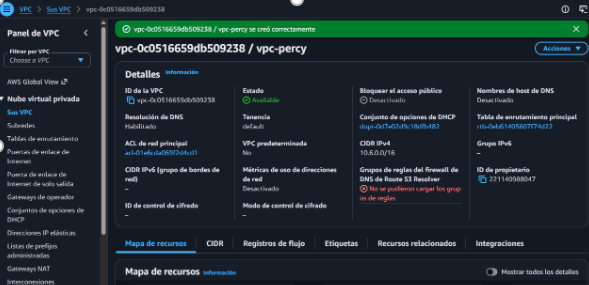

* **Reglas de entrada del Grupo de Seguridad:**  
  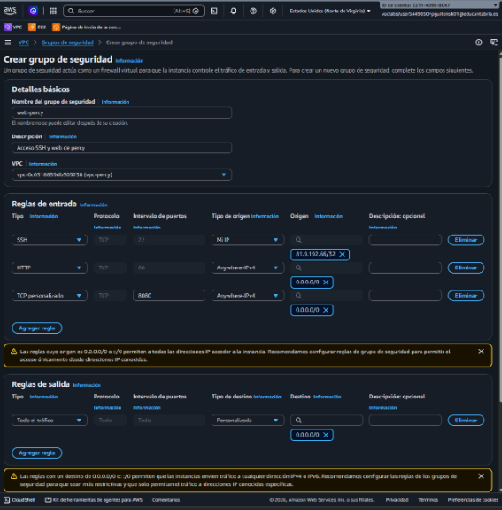

* **Detalle de la Instancia EC2:**  
  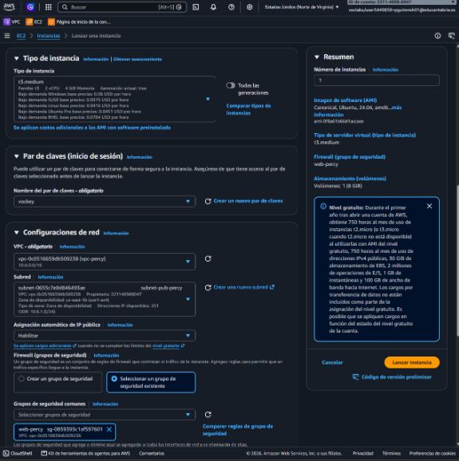

* **Comprobación de la zona horaria (`timedatectl`):**  
  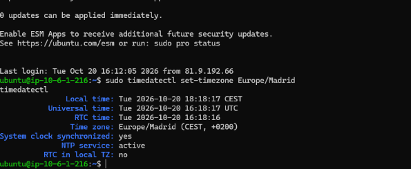

---

## Apartado 2. Instalación y configuración básica de Nginx (CE 3.b)

### Acciones realizadas:
1. **Instalación y Autoarranque:** Se ha instalado Nginx desde los repositorios oficiales de Ubuntu y se ha configurado para que se inicie automáticamente con el sistema operativo (`systemctl enable nginx`).
2. **Sitio por defecto y página de estado:** 
   * Se ha configurado una carpeta propia (`/var/www/default/html/`) cuyo contenido muestra la página principal con el texto **«Servidor web de percy»**.
   * Se ha creado la ruta `/estado` que responde con un texto plano indicando que el servidor funciona correctamente (`Servidor funcionando`).
3. **Ocultar la versión (Investiga):** Se ha añadido la directiva `server_tokens off;` dentro del bloque `http` en el archivo `/etc/nginx/nginx.conf`. Esto evita que las cabeceras HTTP de respuesta y las páginas de error revelen la versión exacta de Nginx o el sistema operativo subyacente.
4. **Validación y Persistencia:** Cada cambio de configuración se ha validado mediante `sudo nginx -t` antes de recargar el servicio de forma segura con `sudo systemctl reload nginx`. Se ha comprobado la persistencia reiniciando la instancia EC2.

### Evidencias:
* **Cabeceras HTTP antes de ocultar la versión:**  
  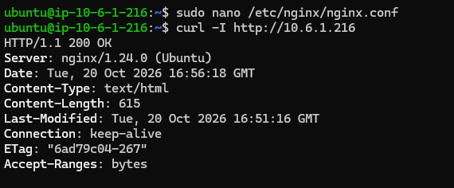

* **Cabeceras HTTP después de ocultar la versión (`server_tokens off;`):**  
  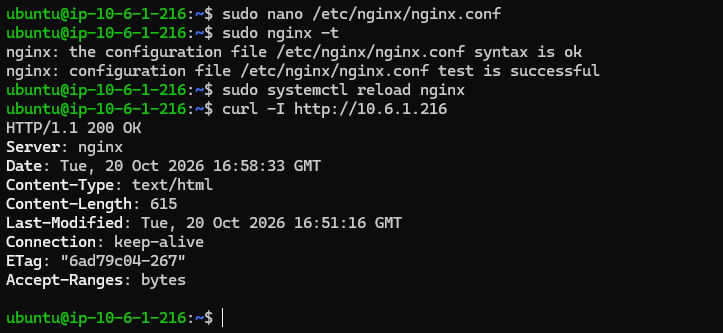

* **Respuesta de la ruta `/estado`:**  
  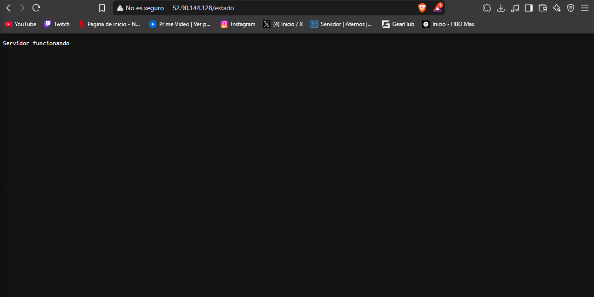

* **Comprobación del servicio tras reiniciar la instancia (Persistencia):**  
  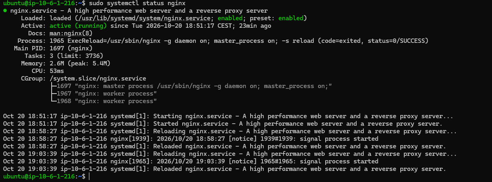

---

## Apartado 3. Sitios virtuales (CE 3.d)

### Acciones realizadas:
1. **Configuración de Sitios Virtuales:** Se han configurado tres nuevos sitios virtuales independientes en `/etc/nginx/sites-available/` y se han enlazado en `sites-enabled/`:
   * **`www.percy.test`:** Web principal en el puerto 80. Responde tanto a `www.percy.test` como a `percy.test` mediante la directiva `server_name www.percy.test percy.test;`.
   * **`blog.percy.test`:** Blog personal en el puerto 80 con la directiva `server_name blog.percy.test;`.
   * **`Intranet`:** Sitio privado sirviendo en el puerto 8080 (`listen 8080;`).
   * **`Sitio por defecto`:** Mantiene la respuesta por defecto en el puerto 80 ante peticiones por IP o dominios no configurados.
2. **Estructura de Directorios:** Cada sitio cuenta con su propio directorio bajo `/var/www/` y un archivo `index.html` personalizado que identifica la web y indica la autoría (`percy`).
3. **Resolución Local (`hosts`):** Se ha modificado el archivo `hosts` en el equipo cliente para asociar los dominios `.test` a la IP pública de la instancia de AWS.

### Evidencias:
* **Configuración del archivo `hosts` local:**  
  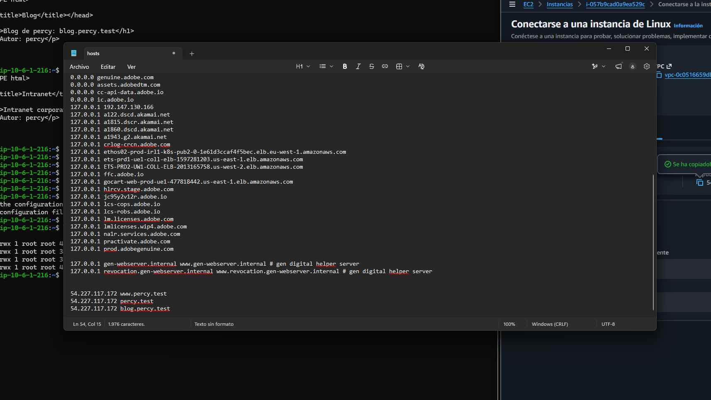

* **Comprobación de sitios activos (`sites-enabled`):**  
  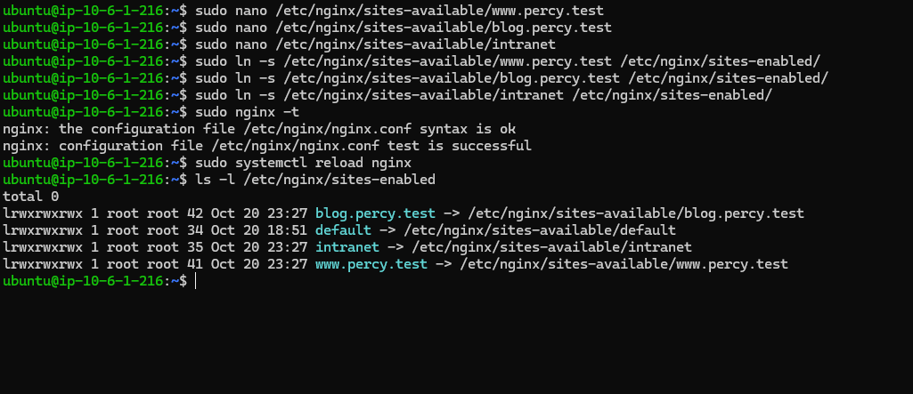

* **Navegación al sitio principal (`www.percy.test`):**  
  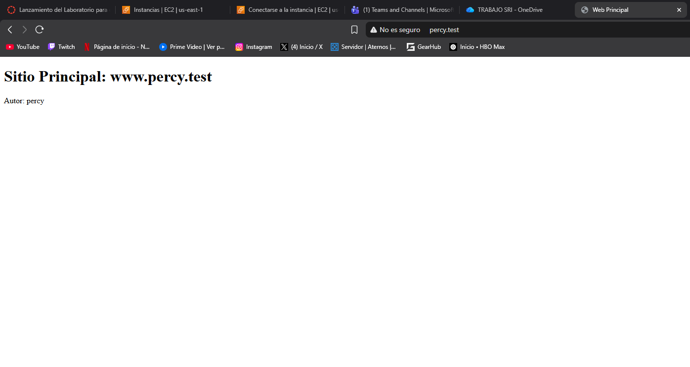

* **Navegación al sitio principal por alias (`percy.test`):**  
  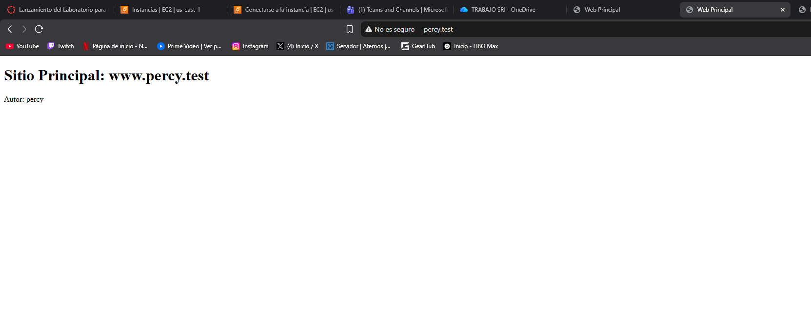

* **Navegación al blog (`blog.percy.test`):**  
  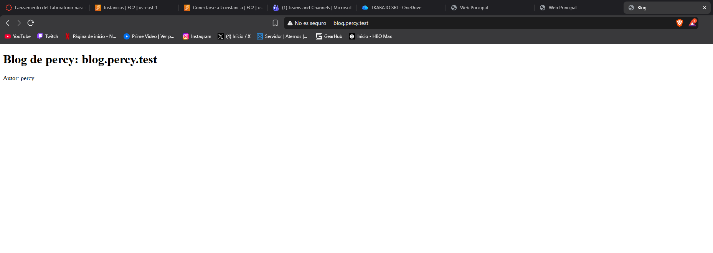

* **Navegación a la Intranet (`http://<IP-PUBLICA>:8080`):**  
  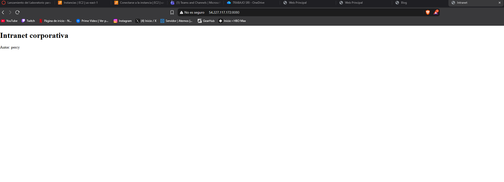

* **Navegación al sitio por defecto por IP (`http://<IP-PUBLICA>`):**  
  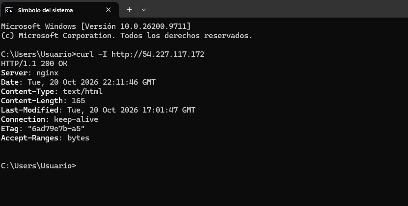 