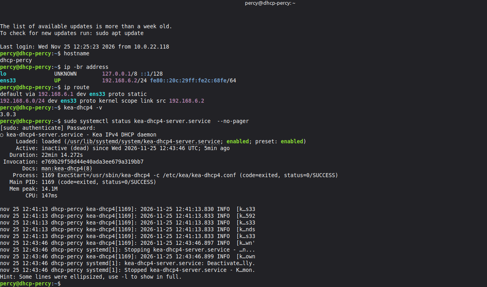
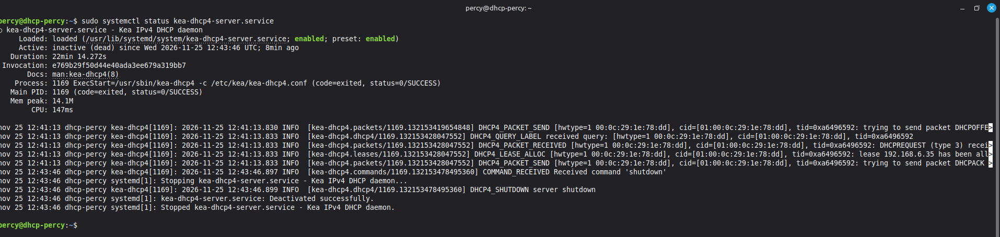
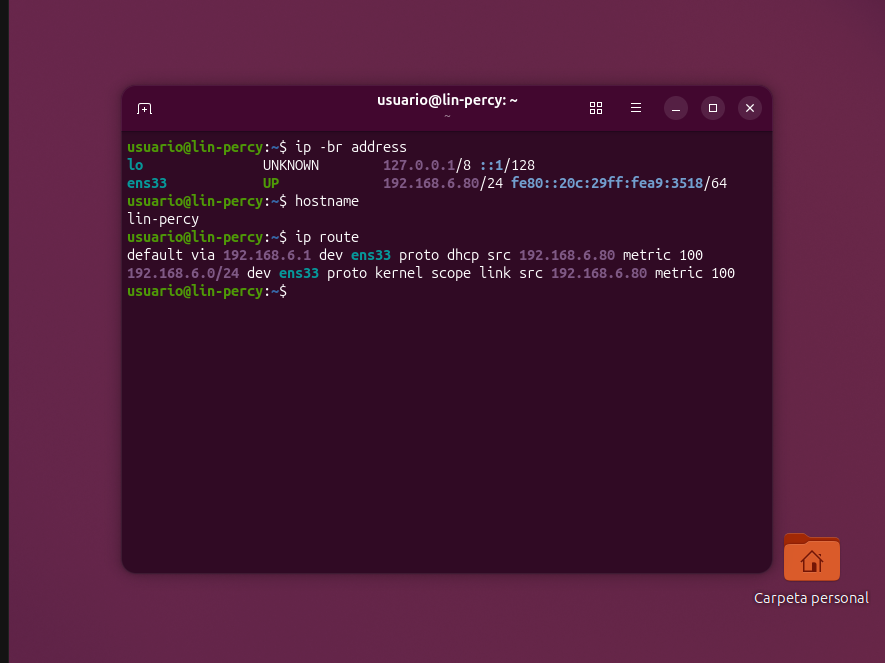
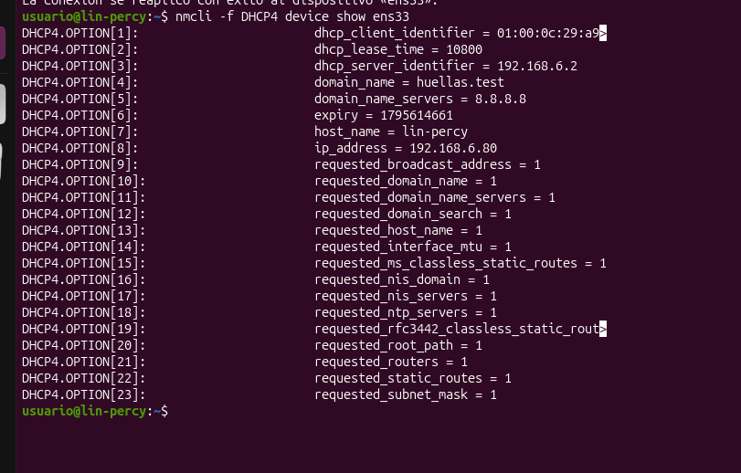
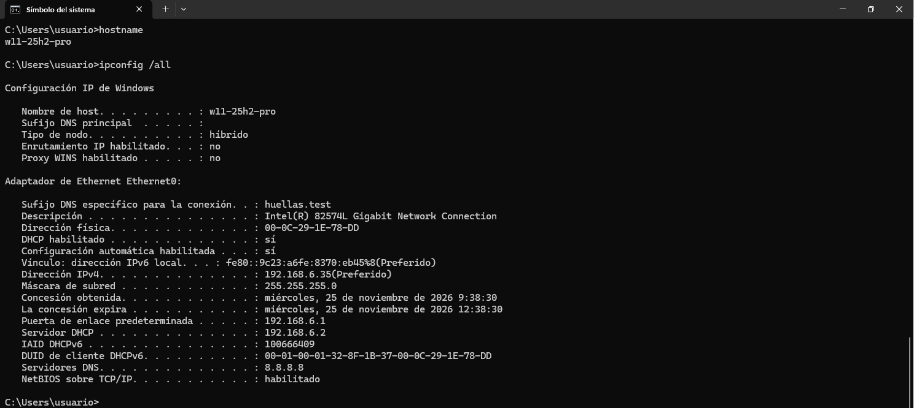
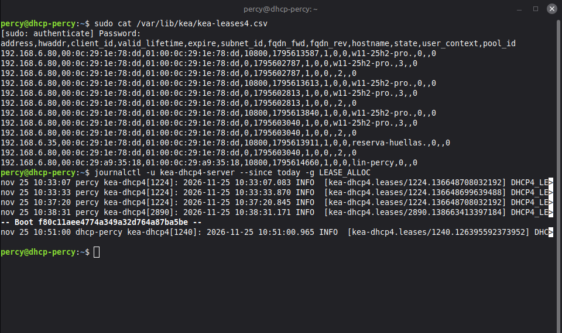
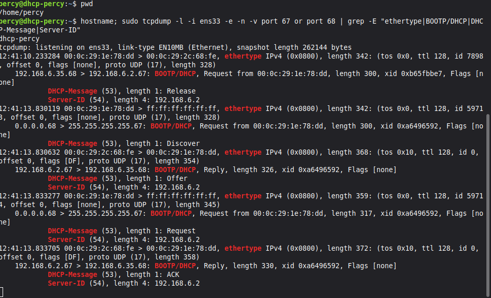
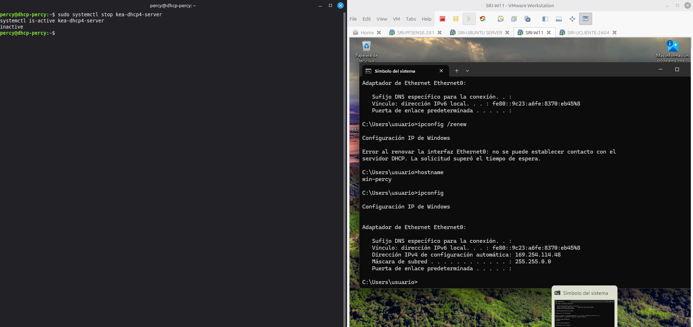

# UT2 · Servicio DHCP de Veterinaria Huellas

| Dato | Valor |
|---|---|
| Nombre | percy |
| Nº de orden (xx) | 06 |
| Empresa | Veterinaria Huellas |
| Dominio | huellas.test |

> Rellena los huecos y sustituye los textos entre `< >`. No cambies el orden de los apartados: es el mismo que el de la lista de cotejo.

## Plan de direcciones

| Equipo | Hostname | MAC | Dirección IP | Cómo la obtiene |
|---|---|---|---|---|
| Router pfSense (LAN) | — | <MAC LAN de pfSense> | 192.168.6.1 | Manual |
| Servidor DHCP | dhcp-percy | 00:0c:29:2c:68:fe | 192.168.6.2 | Manual (fija) |
| Equipo de dirección (Windows) | win-percy | 00:0c:29:1e:78:dd | 192.168.6.35 | Reserva DHCP |
| Puesto de trabajo (Linux) | lin-percy | <MAC de lin-percy> | <IP de E3> | DHCP dinámica (pool) |

| Parámetro | Valor |
|---|---|
| Pools | 192.168.6.80 - 192.168.6.139 y 192.168.6.150 - 192.168.6.200 |
| Exclusión | 192.168.6.140 - 192.168.6.149 |
| Concesión / T1 / T2 (s) | 10800 / 5400 / 9450 |
| DNS del equipo de dirección | 192.168.6.1 (pfSense) y 8.8.8.8 |

## 1. Instalación del servidor · CE 2.c

**Qué demuestra:** Servidor dhcp-percy con IP fija, ruta por defecto y Kea activo y habilitado.

## 2. Configuración básica · CE 2.d

La configuración completa está en [kea/kea-dhcp4.conf](kea/kea-dhcp4.conf).

**Qué demuestra:** La configuración final valida sin errores.

**Qué demuestra:** lin-percy tiene una IP del pool y la ruta por defecto por pfSense.

**Qué demuestra:** lin-percy recibe de Kea la concesión, solo el DNS de pfSense, el dominio y el NTP.

## 3. Asignaciones dinámicas y estáticas · CE 2.e

**Qué demuestra:** win-percy recibe la IP reservada .35, con dos DNS y el sufijo huellas.test.

**Qué demuestra:** Kea registra a los dos clientes en el CSV y en el journal.

## 4. Opciones adicionales · CE 2.f

Se comprueban en `kea-dhcp4.conf` (con el comentario junto a la reserva), E4 y E5. No hace falta nada más aquí.

## 5. Así funciona una solicitud · CE 2.b

**Qué demuestra:** Los cinco mensajes de Windows al liberar y renovar, con sus MAC.

| Mensaje | IP origen | MAC origen | IP destino | MAC destino | Difusión o unicast |
|---|---|---|---|---|---|
| DISCOVER | 0.0.0.0 | 00:0c:29:1e:78:dd | 255.255.255.255 | ff:ff:ff:ff:ff:ff | Difusión |
| OFFER | 192.168.6.2 | 00:0c:29:2c:68:fe | 192.168.6.35 | 00:0c:29:1e:78:dd | Unicast |
| REQUEST | 0.0.0.0 | 00:0c:29:1e:78:dd | 255.255.255.255 | ff:ff:ff:ff:ff:ff | Difusión |
| ACK | 192.168.6.2 | 00:0c:29:2c:68:fe | 192.168.6.35 | 00:0c:29:1e:78:dd | Unicast |

- **xid:** 0xa6496592
- **Identificador del servidor:** 192.168.6.2

**Renovación y caducidad** (con tus tiempos, 3 o 4 líneas):

A los 5400 s (T1) el cliente renueva por unicast con el servidor que le dio la IP. Si no responde, a los 9450 s (T2) hace rebinding: REQUEST por difusión a cualquier servidor. A los 10800 s caduca la concesión y vuelve a empezar con un DISCOVER.

## 6. Informe para la empresa · CE 2.a

**Tres ventajas para Veterinaria Huellas:**

1. Se acaban las IP duplicadas: Kea reparte cada dirección una sola vez.
2. Los portátiles que cambian de consulta se conectan solos, sin tocar nada.
3. El equipo de dirección tiene siempre la misma IP y los visitantes se conectan sin ayuda.

| Mecanismo | Cómo obtiene el equipo su IP | Qué equipo de la oficina lo usa (en APIPA, cuándo aparece) |
|---|---|---|
| Configuración manual | Se escribe a mano en el equipo | Router pfSense y servidor dhcp-percy |
| DHCP dinámica | Kea presta una IP del pool | lin-percy |
| Reserva DHCP | Kea da siempre la misma IP según la MAC | win-percy (.35) |
| APIPA (169.254.x.x) | El propio equipo se autoasigna una IP | win-percy, cuando ningún servidor DHCP responde (E8) |

**Por qué el router y el servidor DHCP no usan DHCP:** Necesitan una IP fija y conocida: el servidor no puede pedírsela a sí mismo y el router es la puerta de enlace de todos.

**Qué demuestra:** Con Kea parado, win-percy se autoconfigura con 169.254.114.48.

## 7. Uso de IA

- [ ] No he usado IA en esta tarea.

| Herramienta | Para qué la usé | Qué comprobé o corregí yo |
|---|---|---|
| | | |
